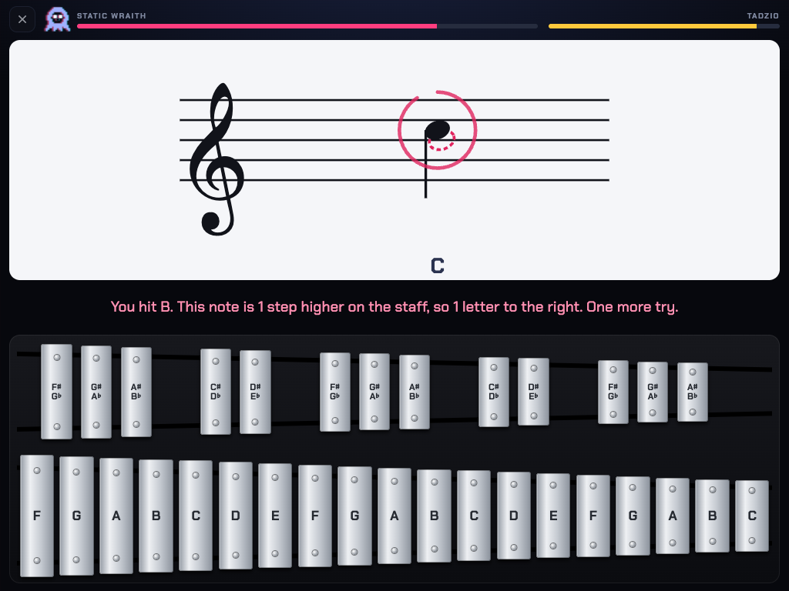

# Overtone

Sight-reading battles for a 32-bar bell kit.

**Play it:** https://bryanwoods.github.io/overtone/



Overtone teaches a beginner to read bell parts in band music. Each turn shows one note on the staff. You hit the matching bar on an on-screen copy of a 32-note student bell kit. Each correct bar damages a monster. A daily session is three battles of about one minute each.

## How a turn works

1. A note appears on the staff.
2. Hit the matching bar before the time ends. A hit in less than 1 second is a crit and does double damage.
3. If you hit the wrong bar, or if the time ends, the monster hits you. You get 4 more seconds and a line that tells you what went wrong.
4. If the second try also fails, the game shows the answer. Hit the glowing bar to continue.

A missed note comes back three turns later. When you run a level again, your missed notes come first.

During a turn, the screen shows only the note, the bells and two thin HP bars. Text shows only for a new note, a miss or an answer. A timer ring closes around the note only when time runs low.

## How it teaches

- **New notes:** the first time a note appears, it has no timer, its letter shows, and its bar glows.
- **Letters that fade:** each note shows its letter until you read it correctly most of the time. Then the letter fades, and later it goes away. This is done for each note, so a new note in a later level starts with its letter again.
- **Read time that adapts:** each correct answer makes the timer 6% shorter, down to a limit for the level. Each miss makes it 15% longer.
- **Mistakes that explain:** the game knows three kinds of mistake. It names the wrong octave, the missed flat or sharp, or the number of steps between the two notes. A dashed note on the staff shows the bar that you hit.
- **A mastery map:** the home screen shows all 32 bars. Each bar has a color for its status: not seen, learning, almost, or mastered.

## The bell kit

The on-screen kit copies a standard 32-note student bell kit:

- The range is F to C, 2½ octaves.
- The front row has 19 natural bars. The back row has 13 sharp and flat bars, in groups of 3, 2, 3, 2 and 3.
- Bell parts are written two octaves below the sound. On the staff, the kit goes from F on the third ledger line below the staff to C on the second ledger line above it.
- Band method books start on concert B♭, C, D, E♭ and F. So the first C is the C in the third space, not middle C.

The game plays each bar at its true pitch, two octaves above the written note.

## Levels

| Stage | Levels | What is new |
| --- | --- | --- |
| Band five | First Notes, Band Five (boss) | B♭, C, D, E♭, F |
| B♭ major | Low Side, B♭ Major (boss) | G and A below, G, A and B♭ above the staff |
| Naturals and flats | Naturals, Flat or Not (boss) | E and B, and how B is different from B♭ |
| Sharps | Sharps, Two Names (boss) | F♯, G♯, C♯, D♯, and one bar with two names |
| Ledger lines | Basement, Attic (boss) | Low F to G, and high E to C |
| All 32 | Full Kit (final boss) | All bars, with both names for each back-row bar |

After the final boss, the Gauntlet sends monsters until you lose.

## Rewards

- XP and player levels.
- A day streak. The streak survives one skipped day.
- A rank from S to D for each battle.
- A daily d20 roll for bar skins. If 90% or more of your answers that day are right on the first try, you roll two dice and keep the higher one.

## Alerts for a parent

The game can send a push alert to a phone through [ntfy](https://ntfy.sh). It sends an alert when a level is cleared for the first time, and when the daily goal of three battles is done. The alert shows accuracy, read time, missed notes, mastered notes and a question to ask, for example "Where is B♭ on your bells?"

1. Install the free ntfy app.
2. In the app, subscribe to the topic in `CONFIG.ntfyTopic` in `index.html`.
3. In the game, tap ⚙ and then **Send test**.

If the device is offline, the game keeps the alert and sends it later.

> [!NOTE]
> An ntfy topic is public. Anyone who knows the topic name can read the alerts. This repository is public, so the topic in `index.html` is public too. Use your own long, random topic name.

## Change the settings

Edit the `CONFIG` object at the top of the script in `index.html`:

| Key | What it controls |
| --- | --- |
| `kid` | The player name on screen and in the alerts |
| `grownup` | The name the player uses for you, shown when an alert goes out |
| `ntfyTopic` | The ntfy topic for alerts. An empty string turns alerts off |
| `maxHp` | The player HP at the start of each battle |
| `dailyRuns` | The number of battles for the daily goal |
| `secondChance` | The seconds for the second try after a miss |

Each level in `LEVELS` has a `read` setting: the start time and the fastest time per note, in seconds.

## Run it locally

The game is one HTML file. It has no build step and no dependencies. The fonts load from Google Fonts.

```sh
python3 -m http.server 8000
```

Then open http://localhost:8000.

To run the logic self-test, open http://localhost:8000/#selftest and read the browser console. The console shows `selftest ok`, or the check that failed.

## Deploy

GitHub Pages serves `index.html` from the `main` branch. When you push to `main`, the live site updates in about one minute.

On an iPad, open the site in Safari and tap **Share**, then **Add to Home Screen**. The game then opens like an app. Safari can delete the data of a website after 7 days without use, but it keeps the data of a Home Screen app.

The browser on each device keeps its own progress in `localStorage`. Progress does not sync between devices.
